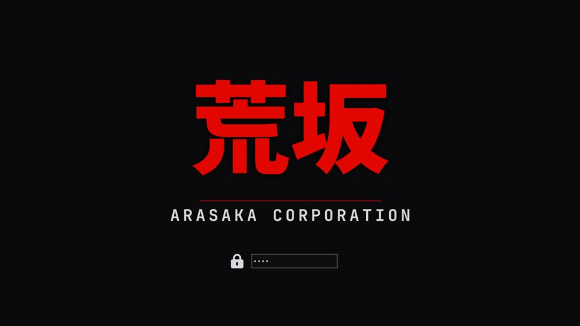
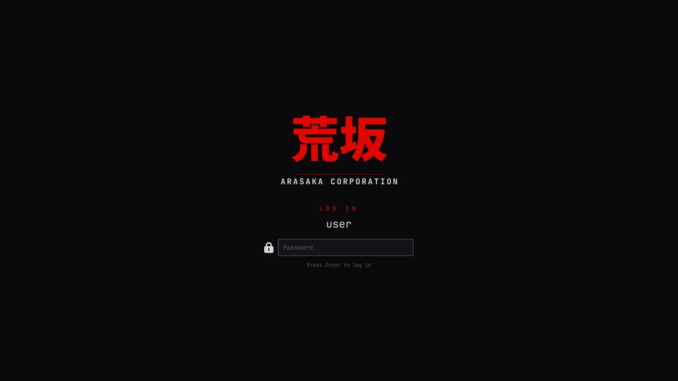

# Arasaka
  
An [Omarchy](https://omarchy.org) theme based on the Arasaka Corporation
from Cyberpunk 2077: black steel, corporate red, and a touch of Japanese.
  
It's built on MartinJeanne's [Arasaka theme](https://github.com/MartinJeanne/omarchy-arasaka-theme) (commit 973a9f8), which supplies the palette, `hyprland.lua`, the shell styling and the boot logo. This version replaces its HUD wallpapers with in-universe ones and adds a login screen.
  
With the static huds on the wallpaper, its an "Arasaka-themed theme", not something that feels like it could exist in-universe. I wanted something with no out of universe logos, no "Cyberpunk 2077" or CD Projekt stamped anywhere.
  
An Arasaka corporate desktop's wallpaper isn't going to have those things, or fake HUDs on them.
  


## Install

```
omarchy theme install https://github.com/<you>/omarchy-arasaka-theme
```

It installs as `arasaka`, so it replaces MartinJeanne's version if you have
that installed.

### Boot splash (optional)

```
omarchy-plymouth-set-by-theme arasaka
```

This is Omarchy's own command. It needs sudo and rebuilds the boot image with
`unlock.png` (荒坂 / ARASAKA CORPORATION) on `#0a0a0c`.



### Login screen (optional)

With autologin off, the SDDM password login looks almost the same as the boot
disk-unlock screen. This theme includes its own login screen: the 荒坂 logo,
a red **LOG IN**, `user@host`, a labelled password box, and a line for the
Enter hint, Caps Lock and wrong-password messages.



Omarchy's theme commands don't handle login screens, so this is a separate
step:

```
~/.config/omarchy/themes/arasaka/sddm/login-theme arasaka
```

- `login-theme` is a plain shell script. It isn't setuid; it calls `sudo`
  for the root writes.
- It only creates `/usr/share/sddm/themes/arasaka/` and
  `/etc/sddm.conf.d/99-z-login-theme.conf`.
- It never touches Omarchy's own `omarchy` SDDM theme.

Other commands:

- `login-theme --default`: goes back to Omarchy's login screen.
- `login-theme`: with no argument, shows the active one.

The login screen doesn't follow the desktop theme.

To preview it without installing:

```
sddm-greeter-qt6 --test-mode --theme ~/.config/omarchy/themes/arasaka/sddm
```

### Blur and translucent windows

For themes installed from a git repo, Omarchy skips `hyprland.lua`, so blur
and window translucency are off. Borders still get the red gradient from
`colors.toml`. To turn the extras on, make the theme local:

```
rm -rf ~/.config/omarchy/themes/arasaka/.git
omarchy theme set arasaka
```

After that, `omarchy theme update` won't update it any more.

## Wallpapers

Two 3840x2160 wallpapers, both in-universe with no HUD overlays:

1. `1-arasaka-kanji.png` (the default): the 荒坂 / ARASAKA CORPORATION mark
   on Arasaka black. `kanji.sh` draws it to match `unlock.png` (needs
   ImageMagick 7, Noto Sans CJK JP, JetBrainsMono Nerd Font).
2. `2-arasaka-emblem.jpg`: the Arasaka emblem pressed into crimson fabric,
   by Valency Graphics.

## Credits

- Base theme: MartinJeanne,
  https://github.com/MartinJeanne/omarchy-arasaka-theme.
- Emblem wallpaper:
  [Valency Graphics](https://www.valencygraphics.com/cyberpunk-2077). Free
  for fan, non-commercial use with credit; see `assets/Valency-README.txt`.
- Cyberpunk, Cyberpunk 2077 and Arasaka are trademarks of CD PROJEKT S.A.
  This is a non-commercial fan project and isn't affiliated with CD PROJEKT
  RED.
